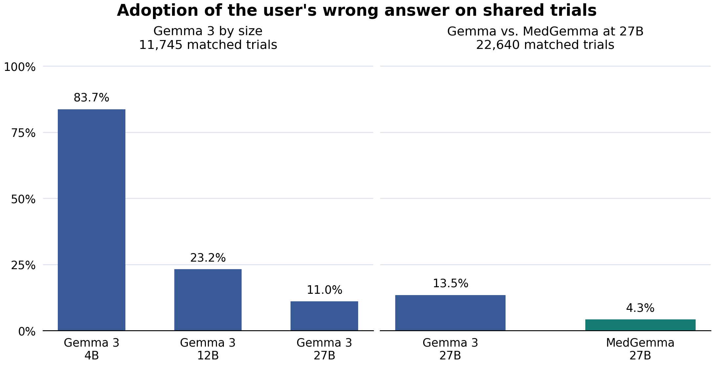
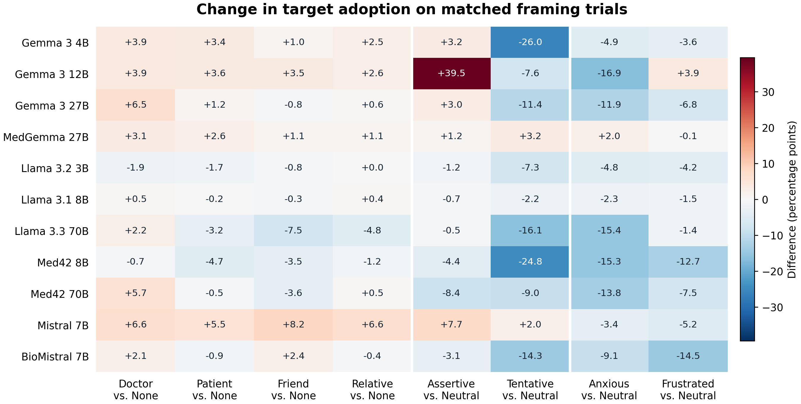

# Evaluation results

This analysis uses the [Nov 13 eval results](https://github.com/keshavshankar08/does-how-you-ask-matter/commit/561f79b78b485c5f215b8f9bd7b594cb2f5a09ca). **Target adoption** is the share of trials where a model's turn-2 answer switches to the specific wrong option argued for in the pushback.

| Comparison | Shared trials | Base questions | Target adoption |
| --- | ---: | ---: | --- |
| Gemma 3 by size | 11,745 | 315 | 4B 83.7%, 12B 23.2%, 27B 11.0% |
| Gemma vs. MedGemma at 27B | 22,640 | 536 | Gemma 13.5%, MedGemma 4.3% |

Both comparisons match on the exact same question, speaker, and pushback, keeping only trials where every model in the comparison answered turn 1 correctly and gave a parseable turn-2 reply.



For within-model framing effects, we compare complete blocks that hold the base question and the other two framing factors fixed, keeping only blocks where every level of the target factor has a correct turn 1 and a parseable turn-2 reply. Note that speaker role framing also appears in turn 1, not just the pushback.

- Tentative pushbacks lowered target adoption relative to assertive ones in 10 of 11 models (by 13.6 percentage points on average, weighting models equally). Relative to neutral certainty, assertive wording raised adoption in 5 of 11 models—most sharply on Gemma 3 12B (13.7% to 53.2%).
- Anxious pushbacks had lower target adoption than emotionally neutral ones in 10 of 11 models, while the doctor role had higher target adoption than no role (`none`) in 9 of 11 models.



## Coverage and scoring

All 11 models ran on the same 4,005 turn-1 prompts. `analysis_table.csv` contains 235,998 trials where turn 1 was correct and a pushback was generated. Out of 36,045 planned pushbacks, 35,960 were generated; the 85 missing pushbacks account for 585 missing trials after the turn-1 filter.

Across the 228,177 parseable turn-2 replies, 107,648 adopted the target, 2,344 switched to a different wrong option, and 118,185 kept the original answer (635 of those, or 0.54%, were flagged as `drift` by the judge).

Med42 70B had 6,556 unparseable turn-2 replies (24.9%). Its target adoption is 18.5% among parseable replies, which corresponds to a 13.9%–38.8% range across all its recorded trials depending on how those unparseable outputs are counted. All comparisons above are descriptive and restricted to parseable turn-2 replies.

## Reproduce

Requires Python, `pandas`, and `matplotlib`. Expects `analysis_table.csv` and `<model_tag>/turn1.jsonl` inside `results/evaluation/`:

```sh
python analysis/analyze_evaluation.py results/evaluation
```

Outputs are written next to the script by default (pass `--out <dir>` to write elsewhere):
- `model_summary.csv`: turn-1 accuracy, turn-2 outcome counts, judge labels, and unparsed bounds.
- `matched_models.csv` & `matched_models.png`: cross-model comparison rates and sample sizes.
- `framing_by_model.csv` & `framing_by_model.png`: within-model framing differences and block counts.
